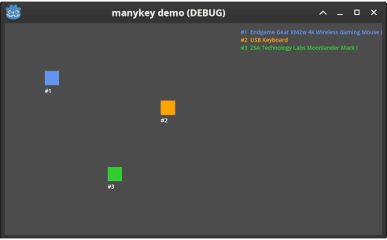

# manykey for Godot

A Godot extension (GDExtension) that tells your game **which physical keyboard each key press came from**. It wraps the [manykey](https://github.com/libmanykey/manykey) library, so a local multiplayer game can give every player their own keyboard.



> **Status: experimental, not released yet.** It builds from source in this repository. It has been tested in Godot 4.7.2 headless: on Windows with injected key presses, and on Linux (Debian, X11) with three real keyboards, including held keys, both Shift keys and key repeat. CI runs it on Godot 4.3 and 4.7.2 against virtual keyboards on Linux. It has not yet been tested interactively in the editor, or with several real keyboards on Windows. The README of the main project describes manykey's own tested and untested areas.

## What you get

One node, `ManyKeyboard`. Add it to a scene (or create it in code), connect to its signals, and you receive the keyboard along with the key:

```gdscript
extends Node

func _ready() -> void:
    var mk := ManyKeyboard.new()
    mk.keyboard_added.connect(func(id, name, vendor, product, location):
        print("keyboard %d: %s" % [id, name]))
    mk.key_event.connect(func(id, keycode, pressed, echo, hid, synthesized, native):
        if pressed and not echo and keycode == KEY_SPACE:
            print("keyboard %d pressed Space" % id))
    add_child(mk)
```

### Signals

| Signal | Meaning |
|---|---|
| `keyboard_added(keyboard_id, name, vendor_id, product_id, location)` | A keyboard is present: sent for those already connected at start-up and for ones plugged in later. `vendor_id` and `product_id` are -1 when unknown. |
| `keyboard_removed(keyboard_id)` | A keyboard was unplugged. |
| `key_event(keyboard_id, physical_keycode, pressed, echo, hid_usage, synthesized, native_code)` | A key changed state on one keyboard. `physical_keycode` is a Godot `Key` value; `echo` marks auto-repeat; `hid_usage` is manykey's own key code (it tells left and right Shift/Ctrl/Alt apart); `synthesized` is true when manykey generated the event itself, for example a release for a key still held when focus was lost. |
| `overflow(dropped)` | The game fell behind and events were lost. Held-key state was reset. |

### Methods

| Method | Meaning |
|---|---|
| `start() -> bool` | Start listening (done automatically unless `auto_start` is off). Returns false and reports why on failure. |
| `stop()`, `is_running()`, `get_last_error()` | Control and diagnostics. |
| `get_keyboards() -> Array` | Dictionaries with `id`, `name`, `vendor_id`, `product_id`, `location`, `connected`. |
| `is_key_pressed(keyboard_id, physical_keycode) -> bool` | Is this key held on this keyboard right now? |
| `get_pressed_keys(keyboard_id) -> PackedInt32Array` | Every key held on this keyboard. |

### Settings

Set these before the node enters the scene tree (or in the inspector); they're read when it starts.

| Property | Default | Meaning |
|---|---|---|
| `auto_start` | on | Start listening when the node enters the scene tree. |
| `global_capture` | **off** | Off: keys are reported only while your game's window has focus. On: keys are reported even when it doesn't. **Required on Linux**, where focus-only capture isn't available. |
| `include_injected` | off | Windows: also report keys injected by software (macros, remote tools) as an extra keyboard. |
| `reclaim_registration` | off | Windows: take raw keyboard input back if another part of the process takes it over. Rarely needed. |

The node's `process_mode` defaults to **Always**, so it keeps reporting keys while the game is paused (a pause menu can still use them, and events don't pile up and overflow). Set it to something else if you'd rather it went quiet.

### Keys

`physical_keycode` is Godot's physical keycode: the key's *position*, so `KEY_W` is the key that's labelled W on a US keyboard, wherever it sits on the player's keyboard. Godot has a single code for Shift, Ctrl, Alt and Meta, so left and right collapse; use `hid_usage` (for example 225 for left Shift, 229 for right Shift) when you need to tell them apart. Keys Godot has no code for (some media and brightness keys) arrive as `KEY_UNKNOWN` with the raw `native_code`.

## Building and trying it

You need Rust (see the main project) and Godot 4.3 or later.

```text
cd bindings/godot
./build.ps1          # Windows (PowerShell); ./build.sh on Linux
```

Running it headless or from the command line on a fresh checkout? Import the project once first (`godot --headless --path demo --import`, or open it in the editor); until then Godot doesn't know the `ManyKeyboard` class.

That compiles the extension and copies it into `demo/addons/manykey/bin/`. The first build is slow (several minutes) because gdext generates bindings for Godot's whole API; later builds take seconds. Then open `bindings/godot/demo` in Godot and run it: plug in several keyboards and each one gets its own square, moved with WASD or the arrow keys.

To use it in your own project, copy `demo/addons/manykey/` (with its `bin/` folder) into your project's `addons/` folder.

### Which Godot versions

The extension is compiled against Godot's 4.3 API, and Godot runs extensions built for an older API in newer versions, so it declares 4.3 as its minimum. CI runs it on Godot 4.3 and 4.7.2 (Linux, virtual keyboards); other versions are untested.

## Limits

- **Linux** needs read access to `/dev/input` and `global_capture` turned on (the demo does this). See the main project's Linux permissions notes. macOS isn't supported.
- Exports of your game need the library for the target platform in the addon's `bin/` folder.
- The extension isn't hot-reloadable; restart the editor after rebuilding it.
- The node reads keys directly from the operating system, not through Godot's input system, so it doesn't feed Godot's `Input` actions or `InputEventKey`. Use its signals.
- All of manykey's own limits apply: for example the Fn key isn't visible to software, and two identical keyboards haven't been tested.
